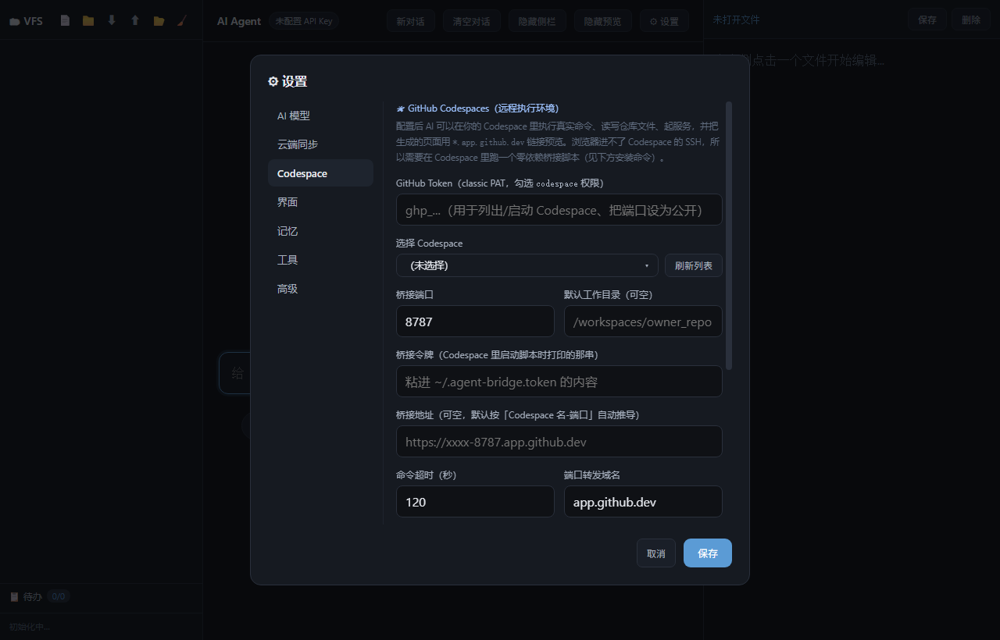

# Agent On HTML

A self-contained AI agent chat application running in a single HTML file.

## Features
- AI chat with multi-provider support (OpenAI, DeepSeek, GLM, etc.)
- Virtual File System (IndexedDB)
- 43 built-in tools (files, search, web, todo, chart, JS/Python sandbox, undo…)
- Cloud sync (Gitee / WebDAV / GitHub Gist / custom endpoint)
- **GitHub Codespaces as a remote execution environment** (real shell, real files, public preview URLs)
- Light/dark theme

## Usage
Open `index.html` in any modern browser, or use the hosted copy:
<https://qiujunawa.github.io/Agent-On-HTML/>

Put an API Base URL + API Key in `⚙ 设置 → AI 模型` and start chatting.

---

## GitHub Codespaces 支持



页面本身跑在浏览器里，碰不到真实文件系统、也执行不了命令。接上 Codespace 之后，
Agent 就有了一个**真实 Linux 环境**：

| 工具 | 作用 |
| --- | --- |
| `cs_exec` | 在 Codespace 里执行 shell 命令（装依赖、跑测试、git…），执行前弹窗确认 |
| `cs_ls` / `cs_read` / `cs_write` | 读写 Codespace 里的真实文件（`cs_write` 支持 `[ref:/vfs路径]`，不必重发长文本） |
| `cs_download` | 把 Codespace 里的文本文件拉进浏览器 VFS（可撤销） |
| `cs_serve` | 起一个静态服务，返回 `https://<codespace>-<port>.app.github.dev` 公网预览地址 |

### 架构

```
index.html（浏览器）
   │  HTTPS + Bearer token，走 GitHub 端口转发（端口需 Public）
   ▼
Codespace → codespace-bridge/server.mjs（零依赖 Node）→ shell / fs / http.server
```

浏览器进不了 Codespace 的 SSH，GitHub 也没有「执行命令」的 REST 接口，
所以桥接是必要的：页面另外用 GitHub REST API 列 Codespace、启动/停止、把端口设为 public。

### 三步接上

1. **开 Codespace**：仓库页 `Code → Codespaces → Create codespace on main`。
   仓库自带 `.devcontainer/`，桥接会自动启动，8787 端口自动转发（首次需把该端口设为 Public：
  Ports 面板右键 → 端口可见性 → 公开，或在页面设置里点「端口设为公开」）。
2. **取令牌**：终端里 `cat ~/.agent-bridge.token`（启动日志也会打印）。
3. **填进页面**：`⚙ 设置 → Codespace` → 填 GitHub Token（classic PAT，勾 `codespace` 权限）
   → 刷新列表选 Codespace → 粘桥接令牌 → 点「检测连接」。

不用本仓库的 devcontainer 也行——在任意 Codespace 终端跑：

```bash
curl -fsSL https://raw.githubusercontent.com/QiuJunawa/Agent-On-HTML/main/codespace-bridge/server.mjs -o ~/agent-bridge.mjs && node ~/agent-bridge.mjs
```

细节（接口约定、环境变量、排查表、安全模型）见 [codespace-bridge/README.md](codespace-bridge/README.md)。

### 安全提醒

桥接端口设为 Public 后，**拿到地址和令牌的人就能在你的 Codespace 里执行命令**。
令牌只存在页面本地（可配合主密码 AES-256 加密），不进对话记录（会做密钥脱敏）；
不用时停掉 Codespace 或在设置里清空令牌。`cs_exec` 默认每次执行都弹窗确认。

---

## License

MIT
